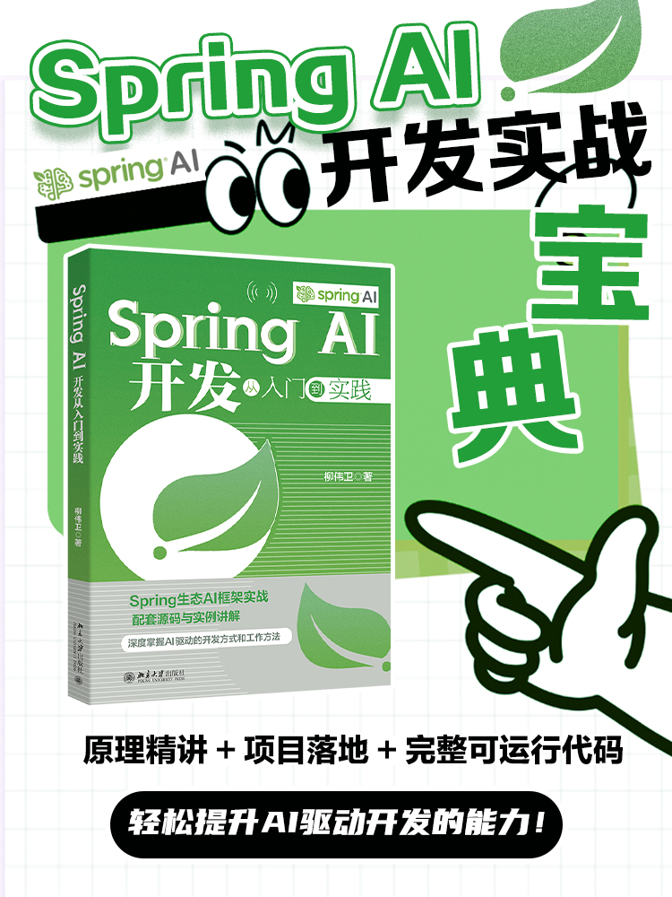

# 《Spring AI开发从入门到实践》示例源码

## 内容简介

 
随着大语言模型（LLM）的爆发式发展，AI驱动开发已成为软件工程领域的核心趋势，而Spring AI作为Spring生态专为AI开发打造的框架，凭借其“约定优于配置”的设计理念、完善的组件生态和低门槛集成能力，成为Java开发者进军AI领域的首选工具。本书以“从入门到实践”为核心导向，系统梳理Spring AI开发的全流程知识，帮助读者快速掌握AI应用开发技能，实现从传统开发向AI驱动开发的转型。

全书共分为五大部分，构建了“基础认知—核心技术—实战应用—进阶拓展—前沿探索”的完整学习路径。第一部分从AI发展趋势与Spring AI核心价值切入，搭配环境搭建指南，帮助读者快速建立认知并完成开发准备；第二部分深入解析Spring AI核心组件与API，涵盖Prompt工程、LLM集成、向量嵌入、提示链、智能体与工具调用等核心技术，夯实开发基础；第三部分聚焦典型应用场景，通过智能问答系统、文本生成、聊天机器人、多模态交互、企业级集成等实战案例，让读者掌握技术落地方法；第四部分围绕性能优化、安全可观测、测试评估、生产部署展开，提供企业级应用上线的全流程保障方案；第五部分探索Spring AI生态与前沿方向，包括开源LLM本地化部署、Agent生态进阶等内容，助力读者把握技术发展趋势。

本书兼顾理论深度与实践价值，每个技术点均配套实例讲解，核心章节设置完整实战项目，同时融入智能体、会话记忆、多模态交互等前沿内容。无论是零基础想入门AI开发的Java开发者，还是需要落地AI项目的企业研发人员，亦或是希望拓展技术边界的IT从业者，都能从本书中获得系统的知识体系与实用的开发指导。阅读本书后，读者将具备独立设计、开发、部署Spring AI应用的能力，轻松应对企业级AI项目的开发需求。

全书总共包含21章，包括：

* 第一部分 基础认知（第1~3章）：从AI发展趋势与Spring AI核心价值切入，搭配环境搭建指南，帮助读者快速建立认知并完成开发准备。
* 第二部分 核心技术（第4~9章）：深入解析Spring AI核心组件与API，涵盖Prompt工程、LLM集成、向量嵌入、提示链、智能体与工具调用等核心技术，夯实开发基础。
* 第三部分 实战应用（第10~14章）：聚焦典型应用场景，通过智能问答系统、文本生成、聊天机器人、多模态交互、企业级集成等实战案例，让读者掌握技术落地方法。
* 第四部分 进阶拓展（第15~18章）：围绕性能优化、安全可观测、测试评估、生产部署展开，提供企业级应用上线的全流程保障方案。
* 第五部分 前沿探索（第19~21章）：探索Spring AI生态与前沿方向，包括开源LLM本地化部署、Agent生态进阶等内容，助力读者把握技术发展趋势。

本书不仅详细阐述了相关理论知识，还配合核心功能给出了诸多开发案例，旨在通过实际操作提升读者的动手能力和解决实际问题的能力。。

## 技术版本

* OpenJDK 26
* Apache Maven 3.9.14
* Gradle 9.4.1
* IntelliJ IDEA 2025.3
* VS Code 1.114.0
* Spring AI 1.1.4/2.0.0-M4
* Spring Boot 3.5.13/4.0.5
* Ollama 0.20.7
* GLM-4.7-Flash
* Qwen3.5
* Nomic Embed Text 1.5
* Chroma 1.4.3
* Memurai for Redis v8.2-RC1
* Cogview-3-Flash
* Guava 33.5.0-jre
* Swagger UI 2.8.16

## 写作背景

在2018年的时候，笔者在北京大学出版社出版了“Spring三剑客”，分别是《Spring Boot 企业级应用开发实战》《Spring Cloud 微服务架构开发实战》《Spring 5 案例大全》。彼时，正是微服务架构、中台架构盛行，Spring Boot和Spring Cloud是构建分布式系统的事实标准。而随着近些年AI大模型技术的爆发，Spring家族也迎来它的新成员——Spring AI——致力于构建AI领域新的事实标准。本书致力于向广大读者推广这门Spring AI技术。

## 源码

所有示例源码，移步至<https://github.com/waylau/spring-ai-tutorial/>  `samples` 目录下
 
内容如下：

* hello-world：Spring AI项目快速初始化
* prompt-template：基于PromptTemplate实现多场景文本生成
* dynamic-llm：多LLM模型适配的文本对话系统
* assistant-tools：多工具协同的智能问答助手
* knowledge-ingest：企业知识库智能问答系统
* vector-store-chroma：企业知识库智能问答系统（Chroma数据库）
* content-process-chain：基于顺序链的客服工单标题生成
* code-assistant：代码生成与优化助手
* copy-generator：智能文案生成系统
* chatbot-demo：多场景适配的智能聊天机器人
* multi-modal：文本与图像双向转换实践
* enterprise-ai：Spring AI与Spring Boot项目深度集成
* lombok：与企业级组件集成

## 配套书籍《Spring AI开发从入门到实践》

与该源码配套的书籍《Spring AI开发从入门到实践》已经出版，内容详见全书[目录](SUMMARY.md)。

本书如有勘误，会在<https://github.com/waylau/spring-ai-tutorial/issues>上进行发布。由于笔者能力有限，时间仓促，难免错漏，欢迎读者批评指正。

您也可以上[豆瓣](https://book.douban.com/subject/39000239/)给老卫打Call。

## 如何获取本书

实体店及各大网店有售。据我所知有如下网站供应：

* [京东](https://item.jd.com/15534218.html)
* [当当](http://product.dangdang.com/30120316.html)
* [淘宝](https://s.taobao.com/search?clientPreloadId=preload_1793443103356&commend=all&ie=utf8&initiative_id=tbindexz_20170306&page=1&preLoadOrigin=https%3A%2F%2Fwww.taobao.com&q=Spring%20AI%E5%BC%80%E5%8F%91%E4%BB%8E%E5%85%A5%E9%97%A8%E5%88%B0%E5%AE%9E%E8%B7%B5&search_type=item&sourceId=tb.index&spm=a21bo.jianhua%2Fa.search_paste.0&ssid=s5-e&tab=all)

想低于市价得到本书？来[二手书集市](https://github.com/waylau/second-hand-books)试试看。

也可以直接关注我博客（<https://waylau.com/>）或者我的开源书（<https://waylau.com/books/>）了解更多免费咨询。

## 联系作者

您也可以直接联系我：

* 博客：https://waylau.com
* 邮箱：[waylau521(at)gmail.com](mailto:waylau521@gmail.com)
* 微博：http://weibo.com/waylau521
* 开源：https://github.com/waylau

## 其他书籍

若您对本书不感冒，笔者还写了其他方面的超过一打的书籍（可见<https://waylau.com/books/>），多是开源电子书。

本人也维护了一个[books-collection](https://github.com/waylau/books-collection)项目，里面提供了优质的专门给程序员的开源、免费图书集合。

## 开源捐赠

捐赠所得所有款项将用于开源事业！见[捐赠列表](https://waylau.com/donate)。
